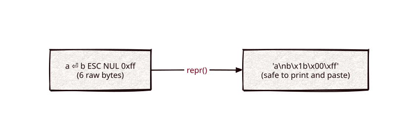

# repr

Part of [Kronuz C++ Libraries](https://github.com/Kronuz/cpp-libraries), a collection of small, reusable C++ libraries.

[](https://github.com/Kronuz/repr/actions/workflows/ci.yml)
[](LICENSE)


Turn any byte buffer into one printable, copy-pasteable line, like Python's
`repr()`, in C++20. For logging and debugging data that may hold control
characters, binary, or embedded NULs.



## ✨ Highlights

- **Safe to print.** Printable ASCII passes through; `\n`, `\r`, `\t`, `\\`, and
  the quote get readable escapes; everything else becomes `\xNN`.
- **Size-based.** Embedded NULs are rendered, not treated as the end.
- **Your choice of quotes**, or none.
- **Truncation.** `max_size` keeps the head and tail of long buffers with `...`
  between them.
- **All-hex mode** for an exact byte dump.

## 📦 Installation

Requires a C++20 compiler and CMake 3.14 or newer; it fetches
[char-classify](https://github.com/Kronuz/char-classify) and compiles one source
file. CI builds it on Linux (x86_64, arm64), macOS (arm64, x86_64), and FreeBSD,
plus ASan, UBSan, and TSan builds.

```cmake
include(FetchContent)
FetchContent_Declare(repr
  GIT_REPOSITORY https://github.com/Kronuz/repr.git
  GIT_TAG        main)
FetchContent_MakeAvailable(repr)

target_link_libraries(my_app PRIVATE repr::repr)
```

## 🚀 Quick start

```cpp
#include "repr.hh"

#include <cstdio>
#include <string>

int main() {
	std::string data("a\nb\x1b\0", 5);
	std::puts(repr(data).c_str());                             // 'a\nb\x1b\x00'
	std::puts(repr(std::string_view("it's"), true, '"').c_str());   // "it's"
	std::puts(repr(std::string_view("AB"), false).c_str());          // '\x41\x42'
}
```

[`examples/demo.cc`](examples/demo.cc) shows every quoting mode and truncation.

## 🎯 When to use it

- ✅ Logging keys, payloads, or protocol bytes you cannot trust to be printable.
- ❌ Escaping for a specific format (JSON, shell, URLs): use that format's escaper.

## ⚡ Performance

`repr` sizes its result exactly (a table gives each byte's output length), then
copies runs of plain printable bytes eight at a time and escapes the rest byte by
byte; with `max_size` the elided middle is skipped by arithmetic, so the cost is
O(`max_size`) however large the input is. On Apple silicon (Apple clang 17, -O3),
against the previous implementation: printable text 2.5-6.6x faster (4 KB: 6.4 us
to 0.96 us, faster than `absl::CEscape`'s 2.2 us), 10% non-printable 2.8-3.4x,
all-binary 1.4x, and `max_size = 64` on a 4 KB / 64 KB input 54x / 940x. Run it
with `cmake -B build -DREPR_BUILD_BENCH=ON && cmake --build build && ./build/repr_bench`;
`ctest` also runs a differential test against the old implementation.

## 📚 Documentation

- [docs/API.md](docs/API.md): the overloads and the `friendly`, `quote`, and
  `max_size` parameters.
- [ARCHITECTURE.md](ARCHITECTURE.md): the escaping and truncation rules.
- [AGENTS.md](AGENTS.md): repository map and invariants.

## 🛠️ Building and testing

```sh
cmake -B build && cmake --build build && ctest --test-dir build
./build/repr_demo
```

## 🤝 Contributing

Issues and pull requests are welcome. Read [AGENTS.md](AGENTS.md) first. CI must
pass on every platform.

## 📄 License

MIT, Copyright (c) 2015-2019 Dubalu LLC. See [LICENSE](LICENSE). Extracted from
[Xapiand](https://github.com/Kronuz/Xapiand).
