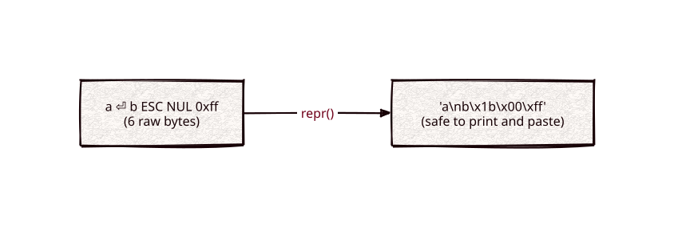

# repr

Part of [Kronuz C++ Libraries](https://github.com/Kronuz/cpp-libraries), a collection of small, reusable C++ libraries.

[](https://github.com/Kronuz/repr/actions/workflows/ci.yml)
[](LICENSE)


Turn any byte buffer into one printable, copy-pasteable line, like Python's
`repr()`, in C++20. For logging and debugging data that may hold control
characters, binary, or embedded NULs.



## ✨ Highlights

- **Safe to print.** Printable ASCII passes through; `\n`, `\r`, `\t`, `\\`, and
  the quote get readable escapes; everything else becomes `\xNN`.
- **Size-based.** Embedded NULs are rendered, not treated as the end.
- **Your choice of quotes**, or none.
- **Truncation.** `max_size` keeps the head and tail of long buffers with `...`
  between them.
- **All-hex mode** for an exact byte dump.

## 📦 Installation

Requires a C++20 compiler and CMake 3.14 or newer; it fetches
[char-classify](https://github.com/Kronuz/char-classify) and compiles one source
file. CI builds it on Linux (x86_64, arm64), macOS (arm64, x86_64), and FreeBSD,
plus ASan, UBSan, and TSan builds.

```cmake
include(FetchContent)
FetchContent_Declare(repr
  GIT_REPOSITORY https://github.com/Kronuz/repr.git
  GIT_TAG        main)
FetchContent_MakeAvailable(repr)

target_link_libraries(my_app PRIVATE repr::repr)
```

## 🚀 Quick start

```cpp
#include "repr.hh"

#include <cstdio>
#include <string>

int main() {
	std::string data("a\nb\x1b\0", 5);
	std::puts(repr(data).c_str());                             // 'a\nb\x1b\x00'
	std::puts(repr(std::string_view("it's"), true, '"').c_str());   // "it's"
	std::puts(repr(std::string_view("AB"), false).c_str());          // '\x41\x42'
}
```

[`examples/demo.cc`](examples/demo.cc) shows every quoting mode and truncation.

## 🎯 When to use it

- ✅ Logging keys, payloads, or protocol bytes you cannot trust to be printable.
- ❌ Escaping for a specific format (JSON, shell, URLs): use that format's escaper.

## ⚡ Performance

`repr` sizes its result exactly (a table gives each byte's output length), then
tests the input a block at a time (16 bytes with NEON or SSE2, 8 with a portable
fallback): a clean block is copied whole and the escapes of any other block are
written from the table. The kernel is [char-classify](https://github.com/Kronuz/char-classify)'s
`chars_escape.hh`, shared with `escape`. With `max_size` the elided middle is
skipped by arithmetic, so the cost is O(`max_size`) however large the input is.
`absl::CEscape` writes a different format, so the benchmark uses it as a speed
reference only. Run the benchmark with:

```sh
cmake -B build -DREPR_BUILD_BENCH=ON && cmake --build build && ./build/repr_bench
```

Time per call, `-O3`, Apple clang 17, on an Apple M4 Pro and an Intel i9-9980HK
(minimum over interleaved samples; `repr_bench` prints the same rows):

| input | M4 Pro: `repr` / `absl::CEscape` | i9-9980HK: `repr` / `absl::CEscape` |
|---|---:|---:|
| printable 16 B | 10 ns / 10 ns | 26 ns / 16 ns |
| printable 256 B | 50 ns / 181 ns | 165 ns / 373 ns |
| printable 4 KB | 450 ns / 2.2 us | 933 ns / 4.0 us |
| printable 64 KB | 7.5 us / 35.2 us | 25.1 us / 63.7 us |
| mixed 10% 64 KB | 12.8 us / 35.6 us | 46.5 us / 61.9 us |
| 10% control bytes, 4 KB | 832 ns / 2.2 us | 1.7 us / 4.1 us |
| binary 4 KB | 1.7 us / 2.2 us | 3.2 us / 4.0 us |

`absl::CEscape` is faster for inputs of a few bytes (up to 16 on the M4 Pro, up to
about 40 on the i9). From 256 bytes up, `repr` is ahead on every row measured.

Against the frozen original (`test/repr_old.cc`, which `repr_bench` samples in turn with `repr`; three runs,
and the bench prints how far apart two sets of samples of `repr` are as A/A), no row of 1 to 16 bytes is
below 0.97x. One printable byte takes 6.5 to 6.7 ns against 7.7 to 7.9 on the M4 Pro (1.15x to 1.20x) and
16.7 to 17.0 ns against 17.8 to 17.9 on the i9 (1.05x to 1.07x); 4 bytes are 1.3x to 1.7x and 1.2x to 1.3x
faster. From 7 bytes up `repr` is 2.5x to 3.6x faster. `friendly=false` (every byte as `\xNN`) is 1.0x to 1.2x
at 1 B and 16 B on both machines, level at 4 KB on the M4 Pro (1.01x to 1.03x) and 1.6x faster on the i9.

[CHANGELOG.md](CHANGELOG.md) has the speedups over the previous implementation.

## 📚 Documentation

- [docs/API.md](docs/API.md): the overloads and the `friendly`, `quote`, and
  `max_size` parameters.
- [ARCHITECTURE.md](ARCHITECTURE.md): the escaping and truncation rules.
- [AGENTS.md](AGENTS.md): repository map and invariants.
- [CHANGELOG.md](CHANGELOG.md): behavior and performance changes.

## 🛠️ Building and testing

```sh
cmake -B build && cmake --build build && ctest --test-dir build
./build/repr_demo
```

## 🤝 Contributing

Issues and pull requests are welcome. Read [AGENTS.md](AGENTS.md) first. CI must
pass on every platform.

## 📄 License

MIT, Copyright (c) 2015-2019 Dubalu LLC. See [LICENSE](LICENSE). Extracted from
[Xapiand](https://github.com/Kronuz/Xapiand).
